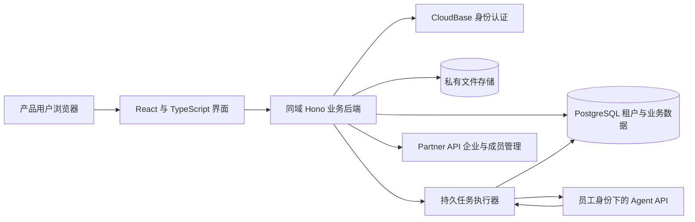

# 架构、CloudBase 与身份配置

按本文件为新应用建立项目内决策；已有项目先保留可验证的兼容行为。

## 默认技术架构

| 层次 | 新项目默认选择 | 约束 |
| --- | --- | --- |
| 前端 | React + TypeScript，Vite 构建的 SPA | 使用严格类型检查；保持这套框架与组件兼容 |
| 路由与状态 | React Router；Hooks、Context、按领域封装的状态 | 按页面懒加载；规模确有需要再引入额外状态库 |
| UI | ZooWork `@zooclaw/design-system`、`@zooclaw/chat-ui` | 直接复用组件与页面骨架，遵守已安装包的类型和主题结构 |
| 样式 | 与 UI 包兼容的 Tailwind CSS 和官方主题 | 业务 CSS 只负责业务布局及确需自定义部分 |
| 后端 | TypeScript + Hono，Node.js 运行于 CloudBase Run | 后端统一处理业务鉴权、秘密、Agent 调用和任务编排 |
| 数据库 | CloudBase PostgreSQL | 新 SaaS 默认使用原生 PG 数据模型和增量迁移 |
| 文件 | CloudBase 私有存储 | 后端授权访问；明确公开的品牌资源另行处理 |
| 用户认证 | CloudBase 身份认证，业务后端校验用户与成员映射 | 按目标 PG 环境实际支持的登录方式接入 |
| AI 执行 | ZooWork Agent API，后端使用员工凭据 | CloudBase 承载应用，不因此改为浏览器直连模型 |
| 持久任务 | 数据库队列／任务表、租约和步骤检查点 | 进程重启、实例替换后可核对和恢复 |
| 质量检查 | TypeScript、Vitest、接口／数据库回归与浏览器验收 | 对鉴权、隔离、版本、幂等和 AI 状态做有意义的测试 |

前端与 `/api` 优先部署在同一来源。浏览器提交业务对象和任务，不提交员工密钥，也不能凭任意 Agent ID 访问上游。静态页面回退不能把未知 API 路径伪装成成功的 HTML 响应。



依赖由 Codex 在初始化时核对兼容性并锁定，提交 `package-lock.json`，使用 `npm ci` 重现；不要同时无审查升级全部大版本。可按 React 19、Vite 7、Tailwind 4、Node.js 24 这一候选组合核对；不要把候选组合当作永久兼容性保证。新项目以运行平台、UI 包的 `peerDependencies` 和实际检查通过的组合为准。

### 共性能力与业务边界

| 提取为通用能力 | 由新业务重新定义 |
| --- | --- |
| 企业、成员、邀请、身份绑定、权限和审计 | 产品名称、行业字段、业务对象与步骤 |
| Partner／Agent 客户端及秘密保护 | Agent 的业务角色、工具范围及输出合同 |
| Agent 实例归属、Skill 版本清单及任务恢复 | 本应用实际需要的 Skill 名单 |
| 私有文件授权、版本校验、后台与用量展示 | 页面、交付格式、审核与协作方式 |
| CloudBase 环境核对、构建、PR 与发布流程 | 是否需要日报、图库、配图、支付或导出 |

不复制原项目的实际环境 ID、域名、服务名、桶名、用户、企业映射、凭据、客户资料、私有字体或行业提示词。从零开发 CloudBase 项目时，不默认引入第二套云平台、SQLite 翻译器或可执行任意 SQL 的通用 RPC。

## 仓库与配置的单一事实来源

新项目可采用以下目录；已有工程保持原有清晰结构，不为目录名字做无关重构。

```text
docs/PROJECT_BASELINE.md      已采用的技术决策、规范版本与例外
docs/PRECHECK.md              前置检查状态、证据与受阻能力
AGENTS.md                    本项目的执行与发布规则，引用已采用的技术决策
PRODUCT.md                   用户、核心流程、边界和验收标准
README.md                    本地启动、预览与正式入口
HANDOFF.md                   已实现范围、实际验证、发布记录与待办
DESIGN.md                    品牌与组件复用、自定义边界
docs/ARCHITECTURE.md          身份、数据、任务与部署架构
docs/DEPLOYMENT.md            环境配置、迁移、发布、回滚
src/components/              按业务划分的 React 页面与组件
src/lib/                     API 封装、类型、Zod 合同与纯业务函数
server/                      Hono API、权限、数据库与上游适配
server/runtime/              Agent 配置、成员客户端和 Skill 清单
server/jobs/                 持久任务、恢复与定时服务
skills/                      本应用自有 Skill 源文件
cloudbase/migrations/         PG 增量迁移
scripts/                     配置检查、方法构建及受控维护
.env.example                 空值示例与变量说明，不含真实秘密
```

阶段、角色、Agent 规格、Skill 名单、状态含义和品牌配置分别只有一个定义源。业务角色与输入输出可以通过共享 TypeScript／Zod 合同复用，但后端模块、秘密配置和员工客户端不能被打包进前端。

安装、配置准入与应用 doctor 的阶段规则见 [开发前置检查](PREREQUISITES.md)。

## CloudBase 初始化与资源隔离

Codex 应依次完成：

1. 检查现有账号及站点。国内站和国际站的账号、环境和凭据不可混用；无法从已知配置或工具状态判断时，只集中确认一次。
2. 解析环境别名，拿到唯一的完整 `EnvId`，核对所属账号、地域、PG 模式和服务。短名称不能直接充当环境 ID。
3. 新 SaaS 使用自身的资源前缀、服务、schema／桶和认证配置。优先使用独立应用环境，测试与正式资源分离；不能因为机器已登录就复用上一个项目的环境。
4. 将非秘密环境信息写入项目配置；管理操作显式指定目标环境。对支持该约定的工具，`.cloudbase/project.json` 记录 `site`、`region`、`envId` 等已确认字段。CLI、MCP 与应用运行时的配置分别核对，不改机器全局设置来掩盖项目冲突。
5. 先准备表、私有桶、身份提供方和权限，再让界面调用；表不存在、桶类型错误或认证未启用时，不用前端假成功绕过。
6. 区分 CloudBase 管理登录、应用用户登录、数据库服务端凭据和 ZooWork 员工身份；四者不能互相代替。
7. 为 CloudRun 提供明确的端口、健康检查、构建与启动命令。实例应无状态；上传文件、租约、运行游标和步骤输出持久化到外部存储。

CloudBase 环境是资源与计费隔离单位，模式和环境 ID 应以实际环境为准。[环境说明](https://docs.cloudbase.net/quick-start/env-overview)

工具名称和可用动作以本次会话的工具说明为准；缺少 MCP 时按已安装的 CloudBase CLI／技能办理。不要自动安装未知远程脚本，不把服务端凭据写进可提交的 MCP 配置。国内／国际站切换和本地／远端 MCP 的认证方式需按官方说明核对。[连接方式](https://docs.cloudbase.net/ai/cloudbase-ai-toolkit/connection-modes)

## 环境变量与秘密管理

### 通用变量合同

以下是默认配置合同约定的应用配置名称；Codex 需要在新项目实现读取、类型校验和缺失处理，不能认为复制变量名就已接入。平台工具的变量名以所选工具为准。

| 名称 | 类别 | 用途与要求 |
| --- | --- | --- |
| `APP_ID` | 非秘密应用标识 | 初始化后保持稳定的应用命名空间，用于资源、外部映射与 Agent 标签；品牌改名不改写它 |
| `CLOUDBASE_ENV_ID` | 非秘密环境标识 | 已核对的完整环境 ID；用于部署、诊断和跨配置一致性校验 |
| `CLOUDBASE_REGION` | 非秘密环境标识 | 目标环境的实际地域，与项目站点记录一致 |
| `CLOUDBASE_SERVICE_NAME` | 非秘密部署标识 | 本应用云托管服务名，由新产品资源前缀派生 |
| `CLOUDBASE_HTTP_BASE` | 后端配置 | 当前环境正式返回的 HTTP API 根地址，不猜测、不沿用旧项目 |
| `CLOUDBASE_APIKEY` | 后端秘密 | 默认 HTTP 后端路径的应用专用服务端 API Key；浏览器不可获得 |
| `CLOUDBASE_SECRET_ID`／`CLOUDBASE_SECRET_KEY` | 条件启用的后端秘密 | 仅所选服务端 SDK 路径需要 CAM 凭据时成对配置；代码显式映射到 SDK 参数，不复用其他项目身份 |
| `CLOUDBASE_SESSION_TOKEN` | 条件启用的后端秘密 | 使用临时 CAM 凭据时的 Token，配合其有效期管理；按所选 SDK 显式映射 |
| `DATABASE_URL` | 条件启用的后端秘密 | 仅 PG 协议直连路径启用，包含数据库连接凭据；默认 HTTP 路径不要求 |
| `CLOUDBASE_STORAGE_BUCKET` | 非秘密后端配置 | 本应用实际创建的私有 PG 桶 ID；代码显式读取，不能保留参考项目默认桶名 |
| `CLOUDBASE_PUBLISHABLE_KEY` | 可公开的初始化配置 | 用于原生认证初始化；不能替代用户登录和权限策略 |
| `CLOUDBASE_CUSTOM_CREDENTIALS` | 按认证方式启用的后端秘密 | 仅自定义登录签票桥接时使用；参考合同为包含 `env_id`、`private_key_id`、`private_key` 的 JSON 字符串，按目标环境官方方式取得 |
| `PORTAL_ENABLED` | 后端开关 | 企业门户启用状态；多企业产品默认启用，不能通过关闭门户恢复旧共享身份 |
| `PORTAL_PROVIDER_ID` | 后端归属标识 | 本部署的明确服务商映射 ID；由初始化流程记录，不能为空或沿用别的项目默认 ID |
| `PARTNER_API_KEY` | 后端秘密 | 当前已授权服务商的管理密钥，用于 Partner API |
| `ENTERPRISE_ENCRYPTION_KEY` | 后端秘密 | 加密员工凭据；采用 Base64 编码的 32 字节随机 AES-GCM 根钥 |
| `SESSION_SECRET` | 后端秘密 | 使用应用会话／签名能力时的独立随机秘密，不复用其他服务的 Key |
| `APP_ORIGIN` | 非秘密后端配置 | 用户实际访问的可信应用来源；正式环境使用已验证的 HTTPS 地址 |
| `PORT` | 运行配置 | 与容器监听和平台探针一致，本地端口与生产端口分别设置 |
| `MODEL` | 可选业务配置 | 经目标员工身份确认可用的默认模型 ID；不把所有员工都能用某模型当成事实 |
| `RUNTIME_ACCOUNT_ID`／`RUNTIME_PROJECT_ID` | 可选维护标识 | 维护命令选择明确员工和其本人业务对象，不接受明文员工 Key 参数 |

后端适配器在本规范中统一使用 `CLOUDBASE_APIKEY`。部分 MCP／CLI 使用 `CLOUDBASE_API_KEY` 等名称；不要凭拼写相近认定已加载，须按对应工具文档分别配置。公开初始化字段优先由后端白名单接口返回；采用 `VITE_*` 时，任何放入其中的值都按“会进入浏览器”处理。

定时服务的执行企业、成员、启停及配置版本保存到数据库。只有确实需要某项定时业务时才定义专用开关和模型配置；不要把某一业务的专用变量作为所有 SaaS 的必填项。

### 应生成的空值示例

Codex 为新项目建立 `.env.example`，类似下列内容，并让配置读取代码与它一致。条件启用项在注释中说明。

使用唯一的 [环境变量模板](../templates/env.example)，按业务条件启用可选项；不要另存不一致的示例。

真实配置放入被 Git 忽略的本地文件或可信秘密存储，生产通过云托管的服务端配置／受控秘密注入机制提供；验证变量是否进入了实际承载流量的服务版本。不要把 `.env` 复制到镜像、上传目录或前端构建产物。服务设置以官方支持方式为准。[CloudRun 服务设置](https://docs.cloudbase.net/run/deploy/service-setting)

### 不可放宽的秘密边界

- 员工 Key 通过 Partner API 在后端取得，采用带身份上下文的认证加密入库。数据库和加密根钥分开保存；成员接口只返回连接状态，不返回密文或明文。
- 禁止引入全局 `ZOOWORK_API_KEY` 或另一把“系统 Agent Key”作备用。所有 Agent 请求都必须解析出具体成员；缺失时拒绝执行。
- 前端、App、URL、仓库、日志、错误响应、Agent 指令、Workflow 序列化输出及 PR 中都不能出现秘密。不能整体回显 `process.env`、请求头或 CloudBase 网关注入上下文。
- 诊断只报告“是否存在、格式是否有效、是否匹配当前环境、只读认证是否成功”等状态；不打印秘密、前后缀或含秘密的完整请求。
- 本地文件有值、进程已加载、服务版本已注入、接口认证成功是四个不同事实。逐行解析配置，不能用跨行正则误报非空。
- 普通重启必须保留加密根钥；根钥丢失不能用生成新根钥冒充恢复。轮换应有版本、受控重加密、回滚和在途任务安排。
- 测试和正式使用不同秘密及资源映射。更换服务商账号时核对企业、成员、库存和资源归属；不只覆盖一个变量就复用旧员工 Key。

## 登录、角色与租户隔离

默认具有服务商管理员、企业管理员、员工三个业务角色。服务商管理员管理企业、服务和用量；企业管理员管理本企业成员与企业用量；员工处理自己有权访问的业务对象。管理角色不自动获得员工私有正文、附件和 Agent／Session 的访问权；需要协作时由产品明确授权规则。

CloudBase 负责原生认证，后端将已验证用户映射为本应用账户、企业与成员。用户名、邮箱、短信等登录方式先检查实际支持和配置；产品需要门户用户名或兼容旧账户时，才增加经验证的自定义登录桥接。不能把管理登录当成客户登录，也不能通过伪造用户 ID 或未验证的前端 Header 建立会话。

采用 BFF 应用会话时使用安全的 HttpOnly Cookie、适当的 SameSite／Secure 设置、失效与撤销机制，并校验写请求来源。原生身份交换须绑定原账户与一次性挑战；生产不能保留公开初始化或万能管理员口令。

| 边界 | 后端必须执行的检查 |
| --- | --- |
| 企业 | 当前会话中的企业归属与服务可用状态 |
| 成员 | 账户有效、成员状态和本次操作权限 |
| 业务对象 | 企业范围＋所有者／明确授权关系 |
| 文件与导出 | 所属业务对象与文件可见性，不只判断已登录 |
| Agent 与 Session | 原成员、实例映射、任务归属和凭据版本 |
| 管理接口 | 业务角色、服务商／企业范围和具体操作权限 |

多标签切换企业时，请求上下文必须与当前登录身份一致。原生图片、字体和下载不能自带业务 Header 时，仅对明确的 GET／HEAD 文件路径作受限例外，仍检查身份与资源权限；不把全部 GET、下载或管理接口设成免鉴权。

PG 的 `service_role` 凭据具有绕过 RLS 的权限，只能保存在后端；因此应用查询仍必须落实租户与资源检查。默认 BFF 模式下，私有表不给浏览器角色授权，启用 RLS 并仅授予受控服务端访问。若业务确需浏览器直连数据，另行设计最小 GRANT 与匹配的 RLS 策略，不能用全表开放代替接入。[PG 身份与权限](https://docs.cloudbase.net/authentication-v2/auth/auth-pg)
